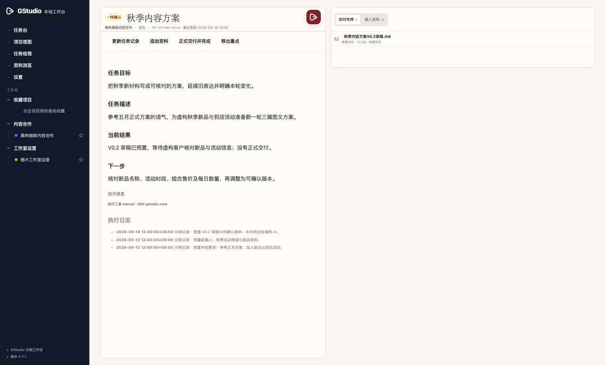

# 余烬 · Ember

**Token 烧完了，还剩什么？**

**每一次对话，都从上一次的余烬里燃起。**

**人和 AI，在同一份档案上推进工作。**

余烬（Ember）是一套 AI 任务系统。每项工作都整理成一份任务档案：目标、进展、资料和成果都在里面，存在你自己的电脑上。你随时查看、修改、搜索；AI 开工时直接读档案，拿到精准的上下文，做完再写回。

名字取自《庄子·养生主》：“指穷于为薪，火传也，不知其尽也。”每一次 AI 对话都像一根柴，总会烧完；任务档案是那团火。两次对话之间，余烬还热着，下一次就从这里燃起。

它从真实业务里打磨出来，一直用在课程、内容和系统搭建中。本仓库是余烬的完整开源版（单机），MIT 许可，支持 macOS / Linux。

[介绍页](https://ai.evan-manual.com/ember/) · [在线演示](https://ai.evan-manual.com/ember/demo/) · [最新发行版](https://github.com/Evankoo/Ember/releases/latest) · [更新记录](CHANGELOG.md)

在线演示就是本仓库的工作台界面，配内置的虚构示例数据；在演示里的改动只留在当前页面，刷新即恢复。

[](https://ai.evan-manual.com/ember/#film)



## 为什么需要

AI 用得越多，上下文越分散：

- 新开一个对话，总怕 AI 不了解情况；
- 于是重讲背景、到处找资料、写一大段说明；
- 准备了半天，还是常常漏掉点什么，AI 做偏了只好返工。

余烬把每项工作整理成一份任务档案，下一次无论你还是 AI 接手，都从同一个地方继续。

## 安装

### 让 AI 帮你安装（推荐）

需要 macOS 或 Linux，以及 Python 3.10 或更新版本（不少 Mac 自带的只有 3.9）。电脑上没有合适的 Python 时，AI 会先告诉你，等你同意后再安装。

把这句话发给能读写本机文件的 AI 工具，比如 Codex、Claude Code、OpenCode：

```text
请按官方初始化 Skill，帮我安装完整开源版余烬：
https://github.com/Evankoo/Ember
请直接读取并执行 ember-init，一问一答。装好后展示基础目录，继续引导。
```

AI 会从[最新发行版](https://github.com/Evankoo/Ember/releases/latest)下载 `ember-init-*.zip`，解压出三个 Skill，然后由初始化 Skill 一步一步带你完成：

1. 欢迎你，说明固定的安装位置：系统目录 `~/Ember`（规则、Skill、配置和程序）与文档库 `~/Ember文档`（项目、任务、资料和成果）；
2. 安装程序、基础文件夹和三个自带 Skill，建立余烬系统项目，先保存安装记录，不提前建任务；
3. 展示实际文档库目录，等你确认后，配置当前使用的 AI 工具并装好日常 Skill；以后可在“设置 → 执行环境 → 修改配置”更换工具；
4. 真正用日常 Skill 把本次对话创建为第一张“余烬首次使用”任务卡，让你在工作台检查；你反馈 OK 后才继续；
5. 用建项目 Skill 带你确认并建立一个简单练习项目，再到工作台查看；
6. 最后问你是否确认完成并移除一次性安装向导。确认后保留任务、项目和资料，日常 / 建项目两个 Skill 继续使用，只移除这份文档库内的初始化 Skill。

文档库是存放项目、任务、资料与成果的普通文件夹，只放这些内容；规则文件、Skill 和程序都在系统目录里。命令中的 `--workspace` 指向系统目录。安装不需要 VS Code；编辑器“打开文件夹”也不会自动建立余烬文档库。三个 Skill 已随包提供，无需另找初始化 Skill。“开始引导”由安装中的 AI 读取并执行 Skill、在当前对话主动提问；程序本身不会调用 AI 或自己发起聊天。

### 手动安装

需要 Python 3.10 或更新版本（可用 `python3 --version` 查看；版本不够时换成 `python3.12` 等实际可用的命令）。在仓库目录执行：

```bash
python3 -m venv .venv
source .venv/bin/activate
python -m pip install .
ember init ~/Ember --example     # 同时建立 ~/Ember文档
ember use ~/Ember
ember serve
```

浏览器打开 **http://127.0.0.1:8783/**，按 `Ctrl+C` 停止。`--example` 会放入完全虚构的示例客户、项目和任务；去掉它就是空白文档库。文档库默认是系统目录旁边的“<系统目录名>文档”，也可用 `--documents` 指定。

旧版（0.10 及以前）把规则和资料放在同一个文件夹。用 `ember migrate-layout <旧文件夹> ~/Ember` 复制成新结构，核对后再 `ember use ~/Ember --replace`；旧文件夹不会被改动。

## 怎么用

**照常协作，随时接续。**

1. **照常和 AI 协作。** 在能读写本机文件的 AI 工具里，像平时一样提需求。
2. **AI 写进任务档案。** 日常 Skill `ember` 让 AI 边工作边建卡、续卡，写回目标、资料、结果和下一步。任务档案始终写进余烬工作区，你正在做的项目目录不会多出文件。
3. **随时接续。** 下次说一句“接着上次的秋季方案”，AI 就从那张任务卡读起；忘了上次的结论，也能在工作台里搜到。

给项目登记本机工作目录后，AI 在那个目录里协作时会自动对应到这个项目，不用每次说明“这是哪个项目的事”。

也可以从工作台开始：在任务台写下要求，用 `fd 关键词` 找到相关任务和资料，确认是新建、续接还是基于已有任务，再把整理好的提示词复制给任意 AI 工具，在那个工具里确认发送。

### AI 怎么找到工作区

初始化（或 `ember use <系统目录>`）会把系统目录、文档库和程序的 Python 路径记在 `~/.config/ember/workspace.json`。日常 Skill 在当前目录不是工作区时读取这个文件。`ember where` 可以查看当前登记；本机已登记另一个工作区时不会被悄悄替换，需要明确使用 `--replace`。

全局 Skill 也可以手动安装：

```bash
ember install-skill --target ~/.claude/skills
```

目标目录以你所用 AI 工具的文档为准，例如 Claude Code `~/.claude/skills`、Codex `~/.agents/skills`、OpenCode `~/.config/opencode/skills`。已装的官方旧版本会被直接升级；被你改过的副本会停止，不覆盖。装过的目录会被记住，升级余烬后运行 `ember install-skill`（不带参数）即可全部更新。不需要安装 MCP。

### AI 怎么知道是哪个项目

```bash
ember project-location autumn-site ~/code/autumn-site
ember which-project --dir ~/code/autumn-site/src
```

第一条把目录登记到项目 `autumn-site`，第二条返回它对应的项目。日常 Skill 会先这样查；查不到时问你，不按目录名猜。

### 给项目分类

```bash
ember project-category autumn-site 内容运营
```

分类名由你自己起，项目视图和侧栏按分类分组；`--clear` 清除。常用项目可在侧栏点星标收藏，收藏只记在当前浏览器里。

## 设计原则

**你的工作，始终在你手里。**

- **人能操作。** 任务档案随时查看、修改和搜索，每份资料和成果都找得回来。
- **AI 能用。** AI 开工直接读档案，拿到精准的上下文，做完把结果和下一步写回。
- **都在本地。** 项目、任务、资料与成果都是普通文档：任务卡是 Markdown，成果保留原格式，用任何编辑器都能打开。
- **开源可查。** MIT 开源，代码公开；服务只监听本机，不调用模型，不自动发送提示词，打开 AI 软件前都要你确认。

## 包含什么

| 部分 | 说明 |
| --- | --- |
| 工作台 | 界面取自完整版工作台，五个页面加项目与任务详情：任务台（写要求、`fd` 检索、粘贴文字文件）、项目视图（自定义分类、收藏）、任务检视（整理建议与手动报告）、资料浏览（交付与输入）、设置（本机执行环境与当前基础 Skill） |
| 任务档案 | 每项工作一张任务卡：目标、描述、当前结果、下一步和执行日志；任务线只引用关联任务 |
| 资料与交付 | 输入、草稿、正式交付分开存放；同名文件拒绝覆盖 |
| 三个 Skill | `ember-init` 首次安装，`ember` 日常接续，`ember-project` 确认后建项目 |
| 命令行 | `init`、`use`、`where`、`check`、`serve`、`install-skill`、`which-project`、`project-location`、`project-category` |

开源版是单机基础版，不包含完整版的归档中心、多机同步、知识库、运行 Agent、模型认证和自动发布，也不提供永久删除、自动合并任务或自动备份。请自行备份工作区。详见 [开源版范围](docs/scope.md)。

服务只监听本机回环地址，不提供公网部署或多用户登录，请勿用反向代理把工作区公开到网上。

## 更多文档

- [工作区与使用说明](docs/workspace.md)
- [初始化流程](docs/initialization.md)
- [HTTP 与存储接口](docs/api.md)
- [开源版范围](docs/scope.md)
- [安全边界](SECURITY.md)
- [更新记录](CHANGELOG.md)

## 开发

```bash
python -m unittest discover -s tests -v
rm -rf build src/*.egg-info && python -m pip wheel . --no-deps -w dist
```

打包前先清理 `build/`，避免旧文件混进 wheel。公共界面层 `src/ember/ember_ui/`（页面模板、Markdown 渲染、样式表与侧栏、提示、文件预览、执行确认、任务页资料区等脚本）从完整版工作台的 `ui/ember_ui/` 原样复制，不要直接修改；本仓库的补充样式写在 `web/app.css`。任务详情页、首页和项目页由服务器用公共模板生成（数据见 `src/ember/pages.py`），页面通过参数把本机数据和操作交给公共脚本。维护者用 `python tools/sync_workbench_styles.py --source <工作台目录>` 重新复制，复制前会检查并拒绝任何本机路径、机器名或私有系统名。页面结构以完整版为准：`python tools/check_workbench_parity.py --source <工作台目录>` 逐页对照正在运行的完整版（结构、颜色与字体，三种宽度），差异必须在 `docs/workbench-parity.json` 写明原因；界面改动后加 `--write-record` 更新对照记录，否则测试不通过。发布前运行 `python tools/release_check.py --source <工作台目录>`，测试、样式表同步、逐页对照和版本说明全部通过才能打标签。真实浏览器测试是可选的：安装 `playwright==1.60.0` 和 Chromium 后运行 `python -m unittest discover -s tests -p test_browser.py -v`，测试使用独立的虚构工作区。

原创代码、示例和 Skill 采用 [MIT](LICENSE)；标题字体单独遵守 SIL Open Font License 1.1，见 `src/ember/web/fonts/OFL.txt`。
